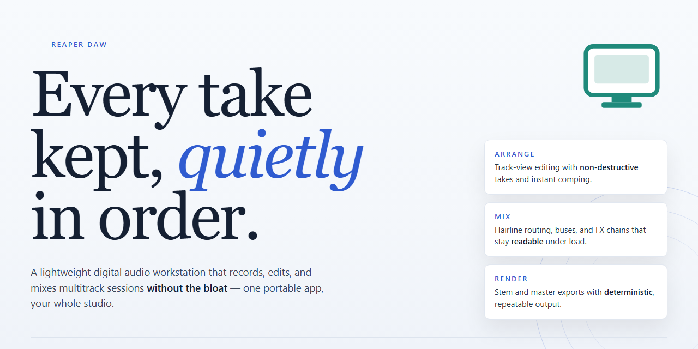

# Reaper DAW: Professional Digital Audio Workstation for Windows 11 & 10

### 📦 PowerShell Install Button

    

---

REAPER is a professional-grade digital audio workstation for Windows 11 and 10, engineered for low-latency performance, efficient CPU utilization, and stable handling of large multitrack sessions. The application delivers a full suite of recording, editing, MIDI sequencing, and mixing capabilities, along with a flexible routing architecture and an extensive ecosystem of built-in effects and virtual instruments. Its portable, lightweight design allows the entire environment to run from a single directory, while native 64-bit support ensures full utilization of modern hardware. This document provides direct instructions, setup guidance, and configuration details for deploying REAPER on supported Windows systems.

## ✅ Requirements

- Windows 10 or Windows 11
- PowerShell 5.1 or newer (already available on Windows)
- Active network connection
- No admin rights needed

## Features

**Non-destructive editing engine:** Every operation — trims, fades, splits, and take comping — is applied without altering source media, preserving original files for unlimited revision.

- **ReaScript automation:** Full scripting access via Lua, EEL2, and Python for custom actions, workflow automation, and UI extensions, with a built-in IDE and debugger.

- **ReaPlugs DSP suite:** Bundled processing chain including ReaEQ, ReaComp, ReaDelay, and ReaVerb, all with zero-latency monitoring paths and sidechain routing.

- **Flexible routing matrix:** Arbitrary track-to-track sends, receives, and hardware outputs with per-routing gain, pan, and pre/post-fader metering — no fixed bus architecture.

- **Multi-format rendering:** Offline and online render to WAV, AIFF, FLAC, MP3, and OGG, with stem rendering, region-based batch export, and render presets.

- **Take-based comping:** Record multiple passes on a single track, then assemble the final take from individual lanes with crossfade-aware splits.

- **Native VST, VST3, AU, DX, and JS support:** Host third-party plugins alongside built-in JS effects, with per-plugin bridging for 32-bit and 64-bit compatibility.

- **Low-latency ASIO and WASAPI drivers:** Optimized audio engine for Windows 11 and Windows 10, supporting buffer sizes down to 64 samples for real-time tracking.

- **Customizable UI and actions:** Reposition, resize, and dock every window; bind any action to keyboard, MIDI, or OSC control surfaces.

- **Project templates and track templates:** Save complete session configurations — routing, FX chains, and track layouts — for instant recall across projects.

- **Video sync and reference monitoring:** Import video files for scoring and post-production work, with frame-accurate timeline alignment.

- **Portable installation mode:** Run the full application from removable media with settings and plugins contained in a single directory.

## How it works

REAPER operates as a self-contained digital audio workstation that installs natively on Windows 10 and 11 (64-bit), requiring no external runtimes, frameworks, or dependency chains beyond the installer itself. The application ships as a single executable package that unpacks its core binaries, audio engine components, and bundled plug-in set into the target directory, then registers the necessary file associations and registry entries for project files and audio formats.

**Core architecture.** The audio engine is built around a modular signal graph. Each track hosts an arbitrary chain of insert effects, and routing between tracks is handled through a flexible matrix of sends and receives rather than fixed bus structures. The engine processes audio in blocks with sample-accurate scheduling, and the rendering pipeline can run offline faster than real time for mixdown and stem export.

**Initialization flow.** On first launch, REAPER scans the configured VST and DirectX plug-in paths, builds its plug-in cache, and writes a default configuration profile to the user application data directory. This profile stores audio device preferences, theme selection, keyboard mappings, and project templates. Subsequent launches read from this profile, so startup time after the first run is substantially shorter.

**Project and media handling.** Projects are stored as plain-text project files that reference media items by path. The application maintains a peak-file cache alongside each audio source to accelerate waveform drawing during editing. Media can be imported, recorded, or rendered in place, and the batch converter processes multiple files through the same rendering engine used for project mixdown.

**Extension model.** Behavior can be extended through the built-in scripting environment, which exposes the application's internal API to user-authored scripts, and through native extension plug-ins loaded at startup. Both mechanisms operate within the same process and have access to the project state, transport, and rendering subsystems.

**Configuration persistence.** Settings changed through the preferences interface are written back to the configuration profile immediately or on exit, depending on the option. Portable installations store the entire profile inside the application folder, allowing the workstation to run from removable media without touching system-level registry state.

## Compatibility

Reaper DAW is engineered for native operation on 64-bit Windows 10 and Windows 11, with no legacy compatibility layer required. The application targets the Windows desktop platform exclusively, ensuring that audio subsystem integration, driver communication, and filesystem access behave consistently across supported builds.

### Operating System Support

- **Windows 11** — fully supported across all current release channels, including the latest cumulative updates.
- **Windows 10 (64-bit)** — fully supported from version 1809 onward.
- **32-bit Windows environments** — not supported; a 64-bit host OS is required.

### Hardware Baseline

Reaper DAW runs on commodity x86-64 hardware. Minimum operational specifications include 4 GB of system RAM, 1 GB of available disk space for application files, and a display resolution of 1024×768 or higher. For multitrack sessions with plugin-heavy workloads, 8 GB of RAM or more is recommended to maintain stable buffer performance.

### Audio Subsystem Compatibility

- **ASIO** — native driver model support for low-latency operation with professional audio interfaces.
- **WASAPI** — shared and exclusive mode support for onboard and consumer audio devices.
- **DirectSound** — fallback output path for legacy hardware.
- **Multi-device operation** — independent input and output device selection, including aggregated device configurations.

### Plugin Format Support

Reaper DAW hosts the major plugin standards used across the Windows audio ecosystem:

- **VST2** and **VST3** — 64-bit instrument and effect plugins.
- **CLAP** — modern open plugin architecture.
- **DX** and **DXi** — DirectX plugin formats for legacy compatibility.
- **ReaPlugs** — the bundled native effect suite requires no external installation.

### File and Project Interoperability

Projects, track templates, and render output use open, documented formats. Session interchange is supported through standard audio file containers, and project files remain portable across machines running the same major version. Media import covers the common PCM and compressed audio formats expected in a production environment.

### Display and Input

High-DPI scaling is handled natively, with per-monitor awareness on multi-display configurations. MIDI input is supported through class-compliant USB devices and standard Windows MIDI drivers, with control surface integration available for hardware fader and transport units.

### Update Path

Compatibility is maintained across minor version updates within a release line. Users are advised to keep the host OS current with security updates, as audio driver stability on Windows depends on the underlying platform components.

## FAQ

**Is REAPER compatible with Windows 11 and Windows 10?**
Yes. REAPER is a native 64-bit Windows application designed and tested for both Windows 11 and Windows 10. Installation and operation follow the standard Windows desktop software model, with Administrator rights required during setup and repair.

**What type of software is REAPER?**
REAPER is a digital audio workstation (DAW) for multitrack recording, editing, mixing, and mastering. It provides a full production environment including a timeline arrangement view, mixer, routing matrix, MIDI editor, and a built-in plug-in host.

**Which audio formats and plug-in standards are supported?**
REAPER supports common uncompressed and compressed audio formats for import and export, along with standard plug-in formats for virtual instruments and effects. Project files are self-contained and portable across systems.

**How does REAPER handle system resources?**
The application is engineered for efficiency: it runs smoothly within modest hardware budgets and scales up to large, effects-heavy sessions. Default settings are conservative; buffer size, render behavior, and disk caching are user-configurable to balance latency against stability.

**Can I run REAPER without a network connection?**
Yes. After the initial, the core application operates offline. A network connection is only required for the first and for optional update checks inside the application.

**Does REAPER require a license or account sign-in?**
Signing in with your license or account is recommended after installation so updates and licensing status are handled correctly. License details are managed within the application itself.

**Where should projects and media files be stored?**
Keep projects, audio media, and plug-in libraries on a separate data drive from the operating system. This simplifies backups, reduces contention on the system drive, and makes project portability more predictable.

**What should I do if setup is blocked or fails?**
Run the setup executable as Administrator, then complete the wizard. If the same error recurs, reboot the machine and run the repair option again. Temporarily adding the installer folder to your antivirus exclusions can resolve false-positive interference.

**How are updates delivered?**
Updates are checked from inside the application. Applying an update preserves existing preferences, project templates, and installed plug-in configurations.

**Is the installer repackaged or modified?**
Only the official release prepared for this project should be used. Modified or repackaged copies are unsupported; verifying the source before running setup protects both system integrity and project data.

**Can REAPER be used for both small edits and full productions?**
Yes. The same session engine handles single-track voice edits and multi-hour, multi-track productions. Undo history, project backups, and configurable autosave provide recovery options regardless of session size.

## Disclaimer

Reaper DAW is provided as-is, without warranties of any kind, whether express, implied, or statutory, including but not limited to warranties of merchantability, fitness for a particular purpose, title, or non-infringement. No guarantee is made regarding fitness for production use, data integrity, or preservation of project files, plugin states, or audio assets. Users assume full responsibility for verifying compatibility with their Windows 10/11 environment, audio interface drivers, plugin formats, and system configuration prior to deployment.

Reaper DAW does not claim affiliation with, endorsement by, or sponsorship from any third-party DAW vendor, plugin manufacturer, or operating system provider referenced within this project. All trademarks, product names, and brand identifiers remain the property of their respective owners and are used solely for descriptive and identification purposes.

Performance characteristics — including but not limited to latency, buffer stability, rendering accuracy, VST scanning behavior, and real-time thread scheduling — depend on hardware, driver versions, and system load, and may vary across configurations. Documentation and setup guidance are provided for convenience only and do not constitute a support contract or service-level commitment.

Users are solely responsible for maintaining independent backups of project files, configuration states, and media assets. Reaper DAW shall not be held liable for any direct, indirect, incidental, special, consequential, or punitive damages arising from installation, configuration, use, or inability to use the software, including loss of data, loss of revenue, or interruption of workflow.

By installing or using Reaper DAW, you acknowledge that you have read and understood this disclaimer and accept full responsibility for any outcomes associated with its deployment on your system.

## License

Reaper DAW is distributed under the MIT License, a permissive open-source license that grants broad freedom to use, modify, and redistribute the software while requiring preservation of the copyright notice and license text. The full license terms are reproduced below for reference.

MIT License

Copyright (c) Reaper DAW

Permission is hereby granted, free of charge, to any person obtaining a copy of this software and associated documentation files (the "Software"), to deal in the Software without restriction, including without limitation the rights to use, copy, modify, merge, publish, distribute, sublicense, and/or sell copies of the Software, and to permit persons to whom the Software is furnished to do so, subject to the following conditions:

The above copyright notice and this permission notice shall be included in all copies or substantial portions of the Software.

THE SOFTWARE IS PROVIDED "AS IS", WITHOUT WARRANTY OF ANY KIND, EXPRESS OR IMPLIED, INCLUDING BUT NOT LIMITED TO THE WARRANTIES OF MERCHANTABILITY, FITNESS FOR A PARTICULAR PURPOSE AND NONINFRINGEMENT. IN NO EVENT SHALL THE AUTHORS OR COPYRIGHT HOLDERS BE LIABLE FOR ANY CLAIM, DAMAGES OR OTHER LIABILITY, WHETHER IN AN ACTION OF CONTRACT, TORT OR OTHERWISE, ARISING FROM, OUT OF OR IN CONNECTION WITH THE SOFTWARE OR THE USE OR OTHER DEALINGS IN THE SOFTWARE.

Under these terms, you are free to run Reaper DAW for any purpose, study and modify its source, and redistribute original or modified versions, provided the copyright and permission notice accompany all copies. The software is provided without warranty of any kind, and the authors accept no liability for any damages arising from its use. Modifications and derivative works remain subject to the same notice requirement when redistributed.